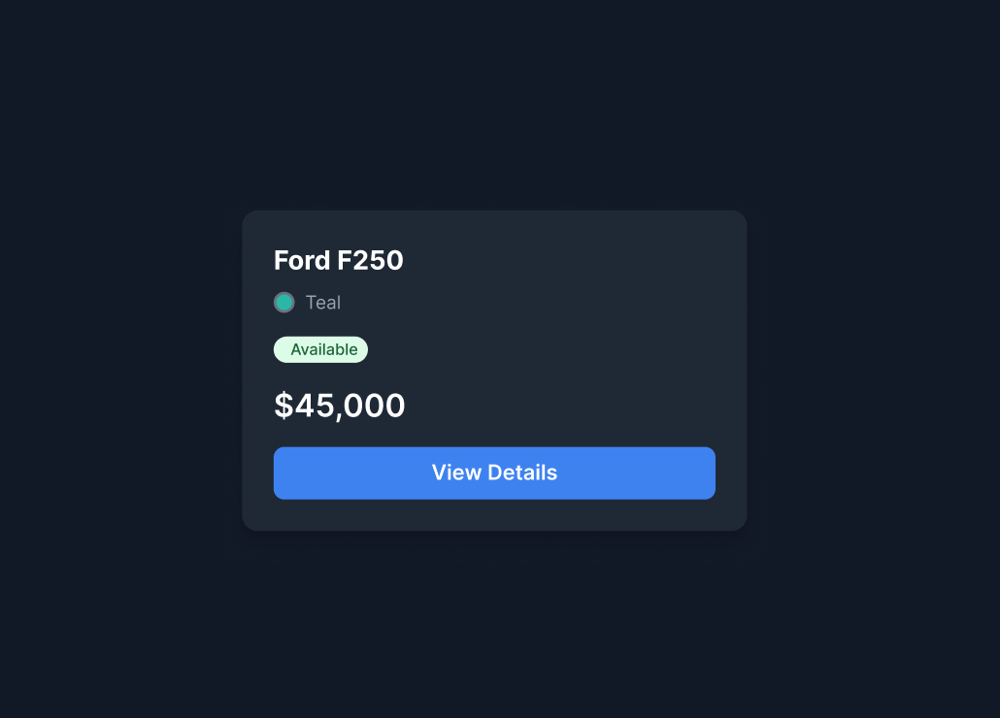
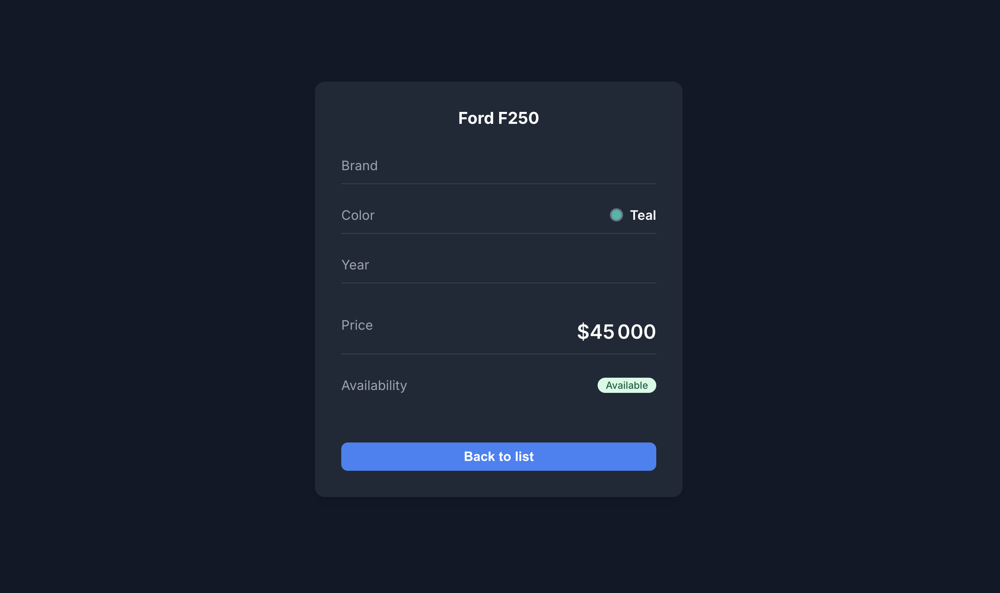

> **Exercice 9 · Énoncé**

# De la maquette au composant React

*Après la carte catalogue faite ensemble, convertir la carte détail d’une voiture (maquette Figma) en composant React stylé.*

| | |
|---|---|
| **Moment** | Jour 2 · Module 06 · Styles en React (Figma) |
| **Durée** | 45 minutes |
| **Niveau** | Débutant à intermédiaire |
| **Prérequis** | Composants, JSX, className, CSS (flexbox), lecture d’une maquette |

## Objectif

Passer d’un design (maquette Figma) à une implémentation React : analyser la maquette, puis reproduire la carte avec un fichier CSS.

> **Remarque :** On ne demande pas du pixel perfect : l’objectif est de se rapprocher au maximum de la maquette. Une différence de 1 ou 2 pixels ne se voit pas.

## Point de départ : la carte faite ensemble

Pendant le module, on a reproduit ensemble la carte catalogue (Card Car) à partir de la maquette Figma :



Ce projet est votre point de départ : `Exercices/Exercice_09/template` (la Card Car faite ensemble). À vous maintenant : ajouter la carte détail (Card Details) sur la même page, en réutilisant les mêmes styles (couleurs, pastille, badge, bouton).

```bash
cd template
npm install
npm run dev
```

## La maquette à reproduire



## Avant de coder : analyser la maquette

- Les **tailles** : largeur de la carte, taille du titre, du prix, du bouton
- Les **couleurs** : fond de la page, fond de la carte, texte, gris des libellés, bleu du bouton, vert du badge
- Les **espacements** : padding de la carte, espace entre les lignes, séparateurs
- Les éléments optionnels ou simplifiables

> **Astuce :** S’il manque des informations dans la maquette, on les remonte à temps à l’équipe UI/UX.

## Étapes

1. Ouvrir le template : la carte catalogue est déjà là, centrée dans la page (`src/components/Home.jsx` et `styles.css`)
2. À côté de la carte catalogue, ajouter la carte détail dans `Home.jsx` (dans un fragment `<>…</>`), et ses styles dans `styles.css`
3. Le titre (nom de la voiture) centré
4. Ajouter les lignes **Brand**, **Color** (pastille ronde de la couleur + nom), **Year**, **Price** et **Availability**, chacune avec le libellé à gauche et la valeur à droite, séparées par une ligne
5. Ajouter le badge **Available** (fond vert clair, coins arrondis)
6. Ajouter le bouton **Back to list** sur toute la largeur de la carte

## Bonus (optionnel)

- Ajouter une variante du badge **Not Available** (fond rouge clair, texte rouge foncé)

## Conseils

- Une ligne libellé / valeur : `display: flex` + `justify-content: space-between`
- La pastille de couleur : un `span` de 12 à 16px avec `border-radius: 50%`
- Le badge : `border-radius` élevé (pilule), petit padding, petite taille de texte
- En React, on écrit `className` (et pas `class`)

## Ressources utiles

- Maquette Figma (mode développeur) : <https://www.figma.com/design/QQo8OKT7hF053RIvEclLrh/Untitled?node-id=22-191&m=dev>
- Figma, inspecter un design (Dev Mode) : <https://help.figma.com/hc/en-us/articles/15023124644247-Guide-to-Dev-Mode>
- MDN, Flexbox : <https://developer.mozilla.org/fr/docs/Learn_web_development/Core/CSS_layout/Flexbox>
- MDN, border-radius : <https://developer.mozilla.org/fr/docs/Web/CSS/border-radius>
- React, ajouter du CSS (className) : <https://react.dev/learn#adding-styles>

## Erreurs fréquentes à éviter

- Écrire `class` au lieu de `className`
- Mettre tous les styles en inline : préférer des classes dans `styles.css`
- Chercher le pixel perfect au lieu d’avancer : on se rapproche de la maquette

## Résultat attendu

- [ ] La carte est centrée sur un fond sombre
- [ ] Chaque ligne a son libellé à gauche et sa valeur à droite
- [ ] La pastille de couleur, le prix et le badge Available sont visibles
- [ ] Le bouton Back to list prend toute la largeur

Bon courage !
